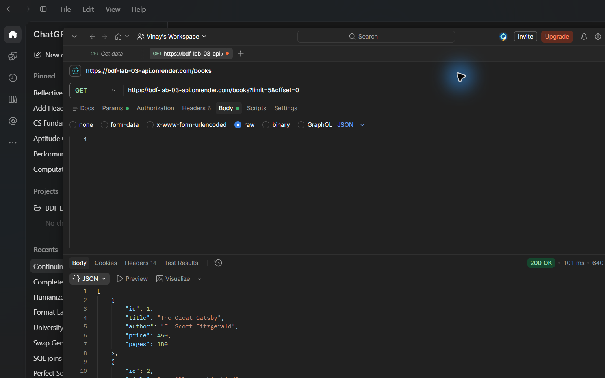
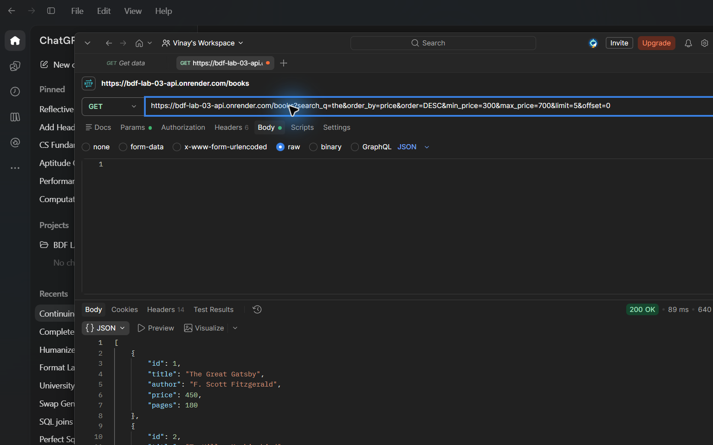
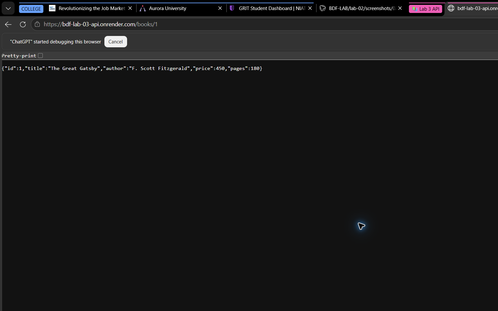
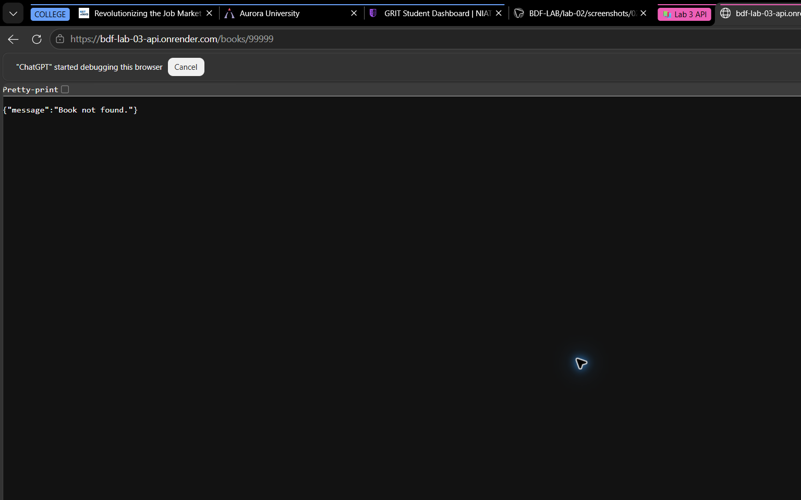
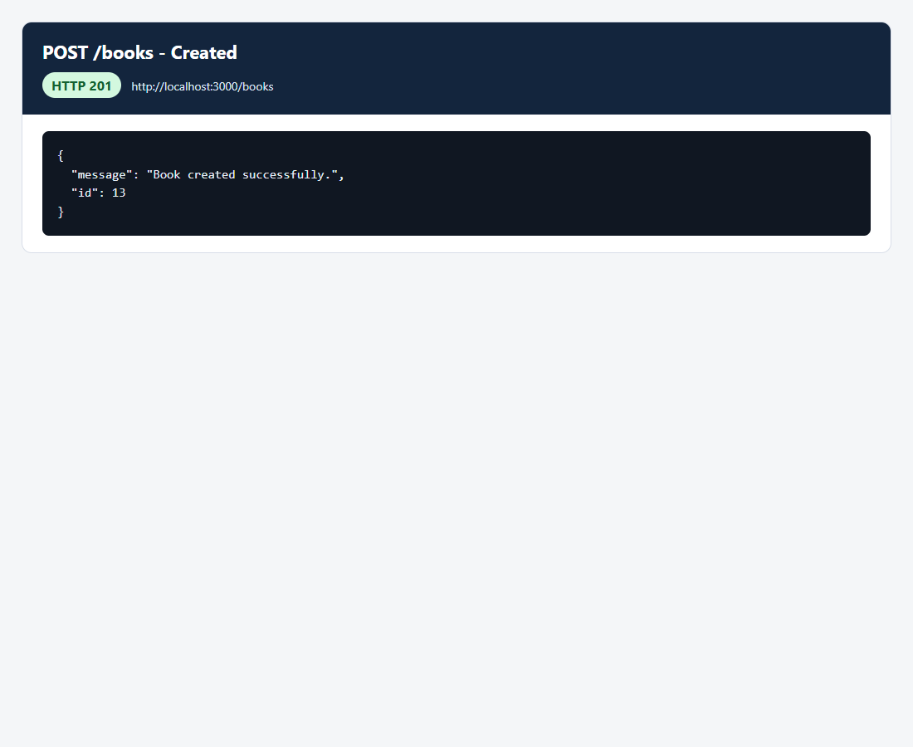
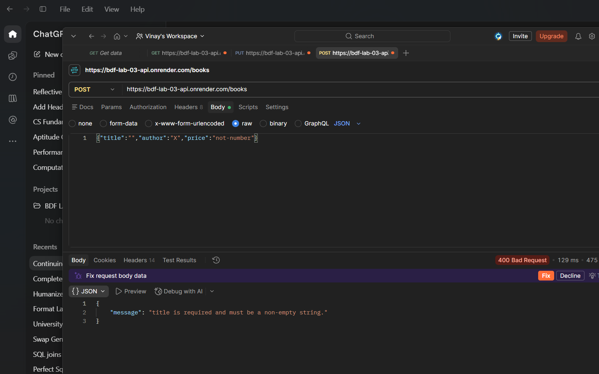
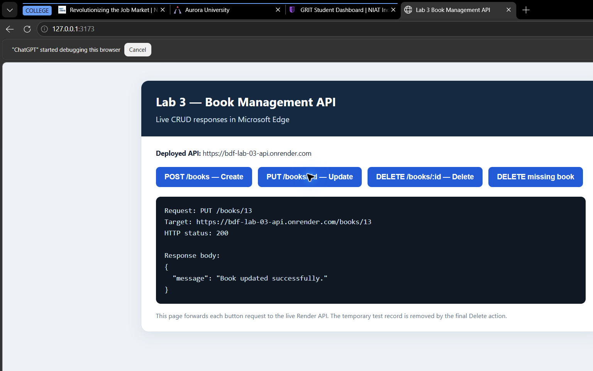

# Lab 3: REST API, query parameters, validation, debugging

**MANDIPALLI VINAY ESHWAR REDDY** · Registration number: **252U1R9094** · Section: **CSE-GEN-AI 2B 111**

**Live link:** [https://bdf-lab-03-api.onrender.com](https://bdf-lab-03-api.onrender.com) · Render free web service (Singapore). The local SQLite catalog is seeded on startup; its contents can reset when the free instance restarts.

## Objective

Extend the Lab 2 SQLite book catalog into a REST API with search, sorting, price filtering, pagination, request validation, consistent JSON errors, and correct HTTP status codes.

## Install and run

Requires Node.js and npm. From this folder:

```bash
npm install
npm run init-db
npm start
```

For automatic restart during development, run `npm run dev`. The server defaults to `http://localhost:3000`; set the optional `PORT` environment variable to another available port if needed. No secrets or `.env` values are required. The SQLite database is created locally as `bookstore.db` and is ignored by Git.

## Endpoints

| Method | Path | Description |
|---|---|---|
| GET | `/` | API welcome message. |
| GET | `/books` | List books; supports `search_q`, `order_by`, `order`, `limit`, `offset`, `min_price`, and `max_price`. |
| GET | `/books/:id` | Retrieve one book by ID; returns 404 when absent. |
| POST | `/books` | Create a book after validating title, author, and numeric price; returns 201. |
| PUT | `/books/:id` | Update an existing book; returns 200 or 404. |
| DELETE | `/books/:id` | Delete an existing book; returns 200 or 404. |

`GET /books` defaults: `order_by=id`, `order=ASC`, `limit=10`, `offset=0`, and no search or price bounds. `order_by` accepts only `id`, `title`, `author`, `price`, or `pages`; `order` accepts `ASC` or `DESC`. All filter and pagination values use bound SQL parameters.

Example: `/books?search_q=the&order_by=price&order=DESC&min_price=300&max_price=700&limit=5&offset=0`.

Errors use `{ "message": "..." }`. Invalid input returns 400, missing records return 404, successful reads/updates/deletes return 200, and successful creation returns 201.

## Postman test list

Use `Content-Type: application/json` for request bodies.

| Check | Request | Expected result |
|---|---|---|
| List defaults | `GET /books` | 200 and up to 10 books, ID ascending. |
| Search/filter/sort/page | `GET /books?search_q=the&order_by=price&order=DESC&min_price=300&max_price=700&limit=5&offset=0` | 200 filtered list. |
| Reject unsafe sort | `GET /books?order_by=title%3Bdrop` | 400 JSON message. |
| Get existing/missing ID | `GET /books/1`, `GET /books/99999` | 200 book, then 404 JSON message. |
| Create | `POST /books` with `{"title":"Test Book","author":"Test Author","price":12.5}` | 201 with created ID. |
| Validate create | Omit title, omit author, or send `"price":"abc"` | 400 JSON message for each. |
| Update existing/missing | `PUT /books/1` with title, author, price; then `/books/99999` | 200, then 404. |
| Delete existing/missing | `DELETE /books/1`; repeat request | 200, then 404. |
| Invalid JSON | Send malformed JSON to `POST /books` | 400 JSON message. |

## Screenshots

The following captures show successful responses and expected error statuses from the running local API.
















## Debugging notes

- **Port conflict (`EADDRINUSE`):** the listener reports the conflict and suggests setting `PORT` to a free port; use only one server per port.
- **Wrong import path:** `setupDb.js` imports the installed `sqlite3` module and reads the schema from `__dirname`, so it works when run from this folder.
- **Table name typo:** the schema and queries consistently use the singular `book` table.
- **Missing `await`:** database open, reads, inserts, updates, and deletes are awaited before their results are used or responses are sent.
- **Render SQLite native binary:** the deployment compiles `sqlite3` from source so the native module matches Render's system libraries.
- **SQL injection:** values use `?` placeholders. Sort column/direction are validated against explicit allow-lists because SQL identifiers cannot be bound as values.

## Viva preparation

- A **query parameter** filters or configures a collection request (`/books?limit=5`); a **path parameter** identifies a resource (`/books/5`).
- **Stateless** means each request contains the information needed to handle it; the server does not rely on hidden client session state between requests.
- Use **400 Bad Request** for invalid input and **404 Not Found** when the requested resource does not exist.
